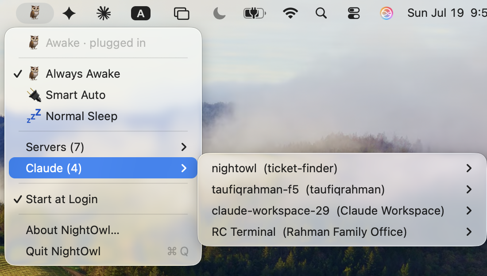

# McAwake 🦉

**Never let a closed lid kill your server again.**

[](https://github.com/taufiqxr/McAwake/actions/workflows/ci.yml)
[](https://github.com/taufiqxr/McAwake/releases)
[](LICENSE)


A tiny menu bar app that keeps your Mac awake — **even with the lid
closed, no external display needed** (the thing `caffeinate` and
Amphetamine can't do) — and tells you what it's staying awake *for*: it lists the local
servers and tunnels the Mac is hosting (and can watch any of them,
alerting you the moment one goes down and again when it's back), and if
you use Claude Code, it doubles as a **session switcher** — every open
session listed by name, one click to jump to its terminal.

Perfect for running bots, agents, home servers, long downloads, or anything
else that needs a Mac awake 24/7 — **turn a MacBook you already own into an
always-on machine, no Mac mini required.**




## Why closing the lid kills your server (and why caffeinate can't stop it)

If you run anything on a MacBook that needs to stay alive (a home server, a
bot, a long download, a build), closing the lid kills it: macOS **force-sleeps**
a MacBook on lid close unless it's docked to both AC power *and* an external
display. Popular keep-awake tools — `caffeinate`, Amphetamine, and friends —
**cannot prevent this**. Their power assertions only stop *idle* sleep; the
forced clamshell sleep ignores them entirely.

The only switch that survives a lid close is macOS's own
`pmset disablesleep`, which requires admin rights and is easy to misuse
(a Mac that *never* sleeps will happily cook in a backpack). McAwake wraps
it in a menu bar app with three explicit modes and an always-visible status.

## What you see

The menu bar icon expresses the full state at a glance:

| Icon | Meaning |
|---|---|
| 🦉 | Always Awake — your Mac will *not* sleep, lid closed or not |
| 🔌 | Smart Auto, plugged in — staying awake because it's on power |
| 💤 | Can sleep — Normal mode, or Smart Auto running on battery |
| 🪫 | The low-battery guard has tripped — sleep allowed until charging |
| ⚠️ | Appended to any of the above when a watched service is down or the daemon isn't running (e.g. 🦉⚠️) |

Hover for a tooltip naming the exact condition. The icon reflects the
*actual* system state (checked every 10 seconds), not just what McAwake
last did — so it stays honest even if something else changes the setting.

## Modes

| Mode | Behavior | Use it when |
|---|---|---|
| 🦉 **Always Awake** | Never sleeps, plugged in or on battery — with a **low-battery guard**: below 15% on battery, normal sleep is restored so a forgotten Mac can't run itself flat (re-arms at 18% or on the charger) | The Mac is a stationary appliance that occasionally goes mobile. |
| 🔌 **Smart Auto** | Awake whenever plugged in; normal sleep on battery | Set-and-forget. Bag-safe by construction: unplugged = normal sleep. |
| 💤 **Normal Sleep** | The macOS default | You want stock behavior back. |

The menu always shows the live status, the power source, and — when on
battery — the current charge percentage.

## The Servers menu

A single **Servers (N)** item lists what the always-awake Mac is actually
hosting — the servers you're keeping it awake *for* — expanding on hover
so the main menu stays clean (the item shows a ⚠️ badge when something
watched is down). Every listening local service (a node dev server, a
Flask app, anything with an open TCP port) appears with its ports; hover
one for a submenu with its PID and per-port
**Open http://localhost:PORT** / **Copy URL** actions. Tunnel clients
(`cloudflared`, `ngrok`) are detected by process, since tunnels dial out
rather than listen.

Design choices worth knowing:

- Detection runs **only when you open the menu** (one `lsof` call) — zero
  idle cost.
- System and browser listeners (AirPlay, `rapportd`, Chrome casting, …)
  are filtered out so the list is your servers, not OS noise.
- Only **process name, port, and PID** are shown — never command lines.
  Command lines can carry secrets (a `cloudflared` tunnel token, for
  example), and a menu should never display one.
- Servers running **as root** aren't visible (detection uses your user
  session's `lsof`) — known limitation.

### Claude

If you use [Claude Code](https://claude.com/claude-code), a **Claude (N)**
item lists every open session by its **session name** (the one you set
with `/rename`, or the auto-generated one) with its project folder — so
even several terminals in the same folder are distinguishable — and a ⚡
marks sessions actively working right now. Hover one for the full path,
PID, tty, busy/idle, running time, and **Jump to this terminal** (brings
that Terminal.app/iTerm2 tab to the front — first use asks for macOS's
automation permission), plus **Reveal in Finder** / **Copy path**. Names
come from Claude Code's own local session files; nothing leaves the
machine. The section disappears entirely when no sessions are running.

### Watching services

Click **Watch** in any service's submenu and McAwake checks it every 60
seconds, posting a macOS notification when it goes down and another when
it comes back — so an always-awake Mac can't silently become a uselessly
awake Mac. Watches survive service restarts and app relaunches (identity
is the port, not the PID), a downed watched service stays visible in the
menu marked **⚠️ DOWN** until you unwatch it, and the first check after a
relaunch primes silently so services that just haven't started yet don't
false-alarm.

McAwake also notifies when the **low-battery guard** acts (trip and
re-arm) and when the sleep setting is changed *outside* McAwake. Smart
Auto's routine plug/unplug transitions stay silent by design. All of this
respects the system notification permission — denying it keeps McAwake
quiet.

首次切换模式时，使用 macOS 管理员授权安装守护进程。此后切换模式无需再次输入密码，应用或电脑重启后仍然有效；守护进程需要修复或更新时可能再次请求授权。应用不保存管理员密码。

## Install

此版本基于 [McAwake 上游项目](https://github.com/taufiqxr/McAwake) 二次开发；上游 Homebrew 包和发布文件不包含本项目的免重复授权修改。

需要 macOS 13 或更新版本，以及 Xcode Command Line Tools。在本工作区根目录运行：

```bash
cd src/mc-awake
./build.sh
open build/McAwake.app
```

应用默认使用简体中文，可在菜单的“语言 / Language”中切换为 English，选择会自动保存；构建和卸载脚本也使用该语言设置。

首次选择模式时，根据系统提示输入管理员密码。应用首次启动时会注册开机登录项，可在菜单中关闭。

也可运行 `./build.sh --install` 安装到 `/Applications`；该操作会退出并替换已有的 `/Applications/McAwake.app`。本版本使用与上游相同的应用和守护进程标识，不能与上游版本同时独立运行。

构建产物使用 ad-hoc 签名，未经过 Apple 公证；若系统阻止打开，请在 Finder 中右键选择“打开”。

### Upgrading from NightOwl (1.x)

McAwake was called NightOwl until 2.0. **Uninstall NightOwl first**, with
*its* `uninstall.sh` — McAwake looks for a daemon named
`com.mcawake.auto` and cannot see, repair, or remove the old
`com.nightowl.auto`. Left behind, that root daemon keeps applying its old
mode every 20 seconds and will quietly override whatever you pick here:

```bash
# from a NightOwl 1.x checkout, or the v1.12.0 source zip
./uninstall.sh          # removes the old daemon + restores normal sleep
```

Then install McAwake and pick your mode again. Two things don't carry
over, because the bundle identifier changed: **watched services** (re-add
them from the Servers menu) and the Start at Login registration. The old
`/var/log/nightowl.log` is harmless if you leave it.

## How it works (and what runs as root)

首次切换模式时，管理员授权用于安装 root LaunchDaemon：

- 启动配置位于 `/Library/LaunchDaemons/com.mcawake.auto.plist`，脚本位于 `/Library/Application Support/McAwake/mcawake-auto.sh`；首次安装会替换原版同名守护进程。
- 守护进程在三种模式下都会保留，并在电脑重启后继续运行。当前模式保存在 `/var/db/com.mcawake/mode`；应用通过仅授权安装时的用户写入的 `/var/db/com.mcawake/control` 管道发送 `normal`、`auto` 或 `always`，守护进程不会将输入当作命令执行。同一用户运行的其他程序也可以发送这些模式指令。
- **Smart Auto** 每 20 秒检查电源：接通电源时设置 `disablesleep 1`，使用电池时设置 `disablesleep 0`。
- **Always Awake** 在电池电量不高于 15% 时恢复睡眠，电量达到 18% 或接通电源时重新阻止睡眠。
- **Normal Sleep** 切换时设置 `disablesleep 0`；守护进程保持运行以接收后续切换，但不会持续覆盖其他程序的电源设置。
- When the daemon restores sleep permission while the lid is already
  closed (guard trip in a bag, or unplugging a closed Smart Auto Mac),
  it puts the Mac to sleep immediately (`pmset sleepnow`) instead of
  waiting for macOS to get around to it.
- The daemon logs every state change (one line each — tiny volume) to:
  ```bash
  tail /var/log/mcawake.log
  ```
- The menu self-checks the daemon: if the process has died, or an app
  update shipped a newer daemon script than the one installed, the menu
  shows a one-click repair/update item. The daemon's decision logic is
  covered by [mock-based tests](tests/test-daemon-logic.sh) run in CI on
  every push.

守护进程不访问网络，不保存密码；卸载脚本会移除守护进程和模式状态，并恢复普通睡眠。

## FAQ

**How do I keep my MacBook awake with the lid closed, without an external
display?**
That's exactly what McAwake is for. macOS only allows closed-lid
("clamshell") operation when the Mac is connected to AC power *and* an
external display; McAwake uses `pmset disablesleep` to keep the machine
running with the lid shut and nothing plugged in at all. Pick 🦉 Always
Awake (or 🔌 Smart Auto if it should still sleep on battery) and close the
lid.

**Is there a free alternative to Amphetamine or caffeinate that survives a
closed lid?**
McAwake is free and MIT-licensed — and closed-lid operation is precisely
the case Amphetamine and `caffeinate` can't handle. Their power assertions
only prevent *idle* sleep; the forced clamshell sleep ignores assertions
entirely. Only `pmset disablesleep`, which McAwake manages, survives a
lid close.

**My screen still turns off and locks when I close the lid — is it even
working?**
Yes — that's the design. The *display* sleeps and locks; the *machine* keeps
running. Check the menu bar icon (🦉 = awake) or run
`pmset -g | grep SleepDisabled` — `1` means every server, download, and
script is still going with the lid shut.

**Will Always Awake drain my battery?**
It will use it, yes — unplugged, the Mac stays fully on. But it won't run
itself flat: the built-in guard restores normal sleep below 15% battery
(and re-arms once you're back on the charger or above 18%). If your Mac
travels a lot, 🔌 **Smart Auto** is still the better fit: normal sleep the
moment you unplug.

**How do I verify what state my Mac is in right now?**
```bash
pmset -g | grep SleepDisabled   # 1 = won't sleep, 0 = sleeps normally
```
The menu bar icon shows the same thing live (🦉 / 💤), and it reflects the
actual system state — not just what McAwake last did.

**Why does it need my admin password?**
`pmset disablesleep` 需要管理员权限。首次使用时，McAwake 通过系统授权对话框安装守护进程；后续模式切换无需密码。修复或更新守护进程时可能再次请求授权，详见 [权限说明](#how-it-works-and-what-runs-as-root)。

**Does the Mac wake up fine afterward?**
Nothing about wake changes — open the lid or press a key as usual. McAwake
only controls whether the Mac is *allowed* to sleep.

## Uninstall

```bash
./uninstall.sh
```

退出应用、移除守护进程与模式状态、恢复普通睡眠（`disablesleep 0`），并删除 `/Applications/McAwake.app`。该脚本需要管理员授权。

## Releasing (maintainers)

Releases are driven by [CHANGELOG.md](CHANGELOG.md):

1. Bump `CFBundleShortVersionString` / `CFBundleVersion` in
   `Resources/Info.plist` (the app and release tooling both read it from
   there — no other version to touch).
2. Add a `## [<version>] — <date>` section to `CHANGELOG.md` describing
   what changed.
3. Commit, then run `./scripts/release.sh` — it refuses to ship without a
   matching changelog section, a clean pushed tree, and passing tests,
   then builds the zip and publishes the GitHub release using that
   changelog section as the release notes.

## Requirements

- macOS 13 Ventura or later (Apple Silicon or Intel)
- 管理员账号（首次安装守护进程及修复、更新时使用 macOS 授权对话框）

## License

MIT — see [LICENSE](LICENSE).
